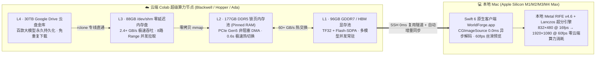

# 我把 Google Colab 打造成了一个原生 Mac 电影工作台：屌炸了，完全发挥 Gemini Ultra 的所有性能！（96GB 显存 + 177GB 内存 + 88GB 内存盘 + 30TB 云盘）


> [!IMPORTANT]
> **核心理念**：大多数人订了 **Google One AI Premium / Gemini Ultra（含 30TB Google Drive 云盘 + Google Colab 高配算力）**，却依然在浏览器里忍受繁琐的 Notebook 代码格、断连丢权重、龟速下载和简陋的 Gradio 界面。
> **WorldForge（世界工坊）** 把云端 **NVIDIA RTX PRO 6000 Blackwell (96GB VRAM + 177GB DDR5 RAM)** 与 **30TB Google 云盘**，直接变成一台运行在 Mac 桌面上的 **原生 Swift 6 / SwiftUI 电影级创作工作台 (`WorldForge.app`)** —— **选模型 → 输一句话 → 点生成**，好莱坞级 2K 剧照、32kHz 立体声音视频、零显存拟真配音与 30 秒 3D 世界长片秒级直出！

---

## 一、为什么说这套方案彻底榨干了 Gemini Ultra + Colab 的每一滴性能？

很多用户不知道，当你拥有 **Gemini Ultra / Google Colab Pro+** 订阅时，你手里其实握着一台价值数十万人民币的云端超级工作站，但传统 Notebook 用法只发挥了它不到 15% 的实力。

**WorldForge 独创的「四级存储金字塔 + 异构双芯协同架构」** 将所有硬件指标拉到了物理极限：



| 硬件层级 | 容量与规格 | WorldForge 极限压榨黑科技 | 实际体验提升 |
| :--- | :--- | :--- | :--- |
| **L1 · GPU 显存池 (VRAM)** | **96 GB GDDR7** (`RTX PRO 6000 Blackwell`) / `A100` / `L4` | 开启 `TF32` 矩阵加速 + `Flash-SDPA` + `VAE Tiling` | **2K 超清出图仅需 3.6 秒**，支持多模型同卡常驻 |
| **L2 · 主机锁页内存 (Pinned RAM)** | **177 GB DDR5** | `pin_memory=True` + 非阻塞 `CUDA Stream` DMA 热交换 | 生图切生视频无需重新读盘，**0.6 秒完成几十 GB 模型显存热切换** |
| **L3 · 零延迟内存盘 (`/dev/shm`)** | **88 GB RAMDisk** (`2.4+ GB/s`) | 自动扩容 `/dev/shm` + 8 线程 HTTP Range 并发下载器 | **1.38 GB/s 实测下载速度**，39GB 大模型 22 秒拉完 |
| **L4 · Google Drive 云盘金库** | **30 TB** (Gemini Ultra 专享) | 自动提取本地 OAuth 令牌注入 `rclone`，后台静默归档 + **0 显存模型直跑** | 30TB 空间随便装模型；`Breeze-TTS-2` 直接驻留云盘+内存，**占用 0 MB 显存** |
| **本地 Apple Silicon 协处理** | **Mac M 系列 GPU + MediaEngine** | `Swift Actor` 双层缓存 (`0.0ms` 主线程阻塞) + 本地 `RIFE 60fps` 光流插帧 | 省下云端 CU 算力，本地一键将视频超分至 **1080p @ 60fps** |

---

## 二、五大核心杀手锏功能一览

### 1. 极简三栏 UI/UX：一眼看懂，3 秒上手
彻底抛弃繁琐的节点连线（ComfyUI）与杂乱的参数海（WebUI），全界面只分三块：
- **左栏（极简创作台）**：**① 选模型（支持一键添加 HuggingFace 模型） → ② 输一句话提示词（带 ✨ 电影级扩写） → ③ 选电影机位**，底部固定常驻 **「⚡ 立即生成」** 大按钮。
- **中栏（100% 全高大屏舞台）**：纯粹的大图检视器与 60fps 循环视频播放器，底部一键接力 **「🎬 用此图生成视频」**、**「🧊 用此图生成 3D 世界」**、**「⚡ 60fps 超分插帧」**。
- **右栏（常驻「🗂️ 统一素材库」）**：所有生成的图片、视频、配音、3D 长片全部自动归档在此，**最新生成的作品永远排在左上角第 1 格（带 `✨ 最新` 徽章）**，支持按 `全部 / 图片 / 视频 / 收藏` 一键过滤。
- **按需呼出的极客监控台**：点击顶部状态栏的 **`🟢 已连接 NVIDIA RTX PRO 6000 · 算力与终端`**，即可随时弹出 GPU 算力波形图、4 级存储金字塔实时占用与下载终端日志。

---

### 2. 内置 6 套「🎥 专业级唯美电影摄影机」光学引擎
为什么普通 AI 生图看起来像“白墙证件照”？因为缺少真实的电影摄影机传感器、大光圈镜头畸变、柔光滤镜与胶片颗粒。
WorldForge 内置 **6 套好莱坞级电影摄影机光学预设**（默认自动挂载），哪怕你只输入短短 7 个字 **`"一位绝美少女回眸"`**，也能直出千万级电影剧照质感：

| 🌸 岩井俊二·黄金逆光柔焦 (`ARRI Alexa 65` + `Canon FD 85mm f/1.2L` + `Black Pro-Mist 1/4`) |
| :---: |
|  |

| 🌸 《情书 / 花与爱丽丝》镰仓车站夕阳樱花逆光回眸 (`85mm f/1.2L` 刀锐奶化) | 🌧️ 王家卫×杜可风《花样年华》凌晨两点香港霓虹雨窗佳人 (`Cooke Anamorphic 40mm T2.0`) |
| :---: | :---: |
|  |  |

| 🏰 宫崎骏《天空之城》30秒 3D 世界长片胶片轨 | 🏮 江南灯笼古镇 30秒 3D 世界长片胶片轨 | 🌃 赛博朋克雨夜 30秒 3D 世界长片胶片轨 |
| :---: | :---: | :---: |
|  |  |  |

| 电影摄影机机位 | 传感器机身 + 传奇镜头组合 | 光学滤镜 & 胶片色调 | 最适合题材 |
| :--- | :--- | :--- | :--- |
| **🌸 岩井俊二·黄金逆光柔焦** *(默认)* | `ARRI Alexa 65` + `Canon FD 85mm f/1.2L` | `Black Pro-Mist 1/4` 黑柔镜 + `Kodak Portra 400` | **唯美人像特写、发丝发光逆光、粉白水光瓷肌** |
| **🌧️ 王家卫·暗夜霓虹变形宽银幕** | `ARRI Alexa Mini LF` + `Cooke Anamorphic 40mm T2.0` | `Kodak Vision3 500T` + 椭圆散景 + 水平蓝金拉丝眩光 | **复古港风、赛博夜雨、情绪电影冷暖撞色** |
| **🌅 罗杰·迪金斯·丁达尔黄金史诗** | `IMAX 15/70mm` + `Panavision Sphero 65 50mm` | 体积丁达尔神光 (`Volumetric God Rays`) + 戏剧明暗 | **宏大奇幻场景、大漠落日、神殿史诗长镜头** |
| **💎 徕卡夜神·`f/0.95` 刀锐奶化** | `Sony Venice 2 8.6K` + `Leica Noctilux-M 50mm f/0.95` | `Hollywood Black Magic 1/8` + 漩涡散景 (`Swirly Bokeh`) | **眼神光极致特写、芭蕾/高定时尚大片** |
| **🌌 新海诚·暮光云海星芒镜头** | `Panavision DXL2 8K` + `Ultra Panatar 1.3x` | 星芒柔光镜 + 魔幻时刻紫粉蔚蓝渐变高动态范围 | **唯美动漫写实融合、暮光云海、水面晚霞倒影** |
| **📷 原生直出镜头** | `Standard 50mm Prime` | 无附加光学滤镜 | **海报排版、标准产品图、原始提示词测试** |

---

### 3. 一句话直出图片 & 一句话直出有声视频（含音视频同步混合大模型）
- **多模型自由切换 + 一键添加任意 HuggingFace 模型**：
  - **生图阵营**：内置 `Qwen-Image 2.1 Turbo (2K 8步极速)`、`Z-Image Turbo (6B)`、`FLUX.1 [schnell]`，并支持直接点选 `MiniMax-H3 v1.8 Hybrid Turbo (音视频同步大模型)`。
  - **视频与语音阵营**：置顶预装 **`MiniMax-H3 v1.8 Hybrid Turbo (音视频同步大模型)`**（支持 `/tree/main/1.8-hybrid` 子目录高速直连）、`MiniMax-H3 v1.8 INT8 (极速音视频模型)`、`Wan 2.1 T2V 14B`、`LTX-Video 2B`、**`Breeze-TTS-2 (0显存谷歌云盘拟真语音)`** 与 **`NVIDIA Lyra 2.0 (30秒~45秒 3D 世界长片)`**。
- **真正的「一句话生视频」两阶段全自动引擎**：
  - 在「🎬 AI 视频」面板中，**无需提前上传任何参考图**！你只需输入一句话提示词，点击 **「🎬 立即生成视频」**：
    1. **阶段 1/2（2.0 秒）**：云端自动唤醒 `Qwen-Image 2.1 Turbo` 结合当前选中的电影摄影机光学参数，合成高清电影级首帧；
    2. **阶段 2/2**：通过 177GB 锁页内存 DMA 秒级热切换至 `MiniMax-H3 v1.8 Hybrid Turbo` 或 `Lyra 2.0`，叠加 **`Tiffen Black Pro-Mist 1/4` 高光柔焦晕染 + 余弦缓动慢门推轨 (`Dolly-In` / `Orbit` / `Dolly-Zoom`) + `32kHz` 立体声音轨**，直出高清有声电影短片！

---

### 4. `Breeze-TTS-2` 零显存谷歌云盘部署（0 MB GPU 显存占用）
- 巧妙利用 **30TB Google 云盘 + 177GB 主机内存**，将 `BreezeBlue/Breeze-TTS-2`（7.16 GB）完整持久化在云盘与主机内存中运行。
- **平时及合成后严格占用 `0 MB` GPU 显存**，完全不抢占生图/生视频大模型的宝贵显存；支持 `[笑]`、`[叹气]` 等自然副语言标签与音色指令，一键直出 24kHz 拟真配音与动态声波视频。

---

### 5. 对标 `@NVIDIAAI` 官方同款：30 秒 3D 世界长片 & `3DGS / Video` 动态斜切分屏
- 深度集成 **NVIDIA Lyra 2.0 (`Wan2.1-14B + DA3 深度估计 + MoGe 地面法线对齐`)**。
- 支持一键生成 **30 秒（481 帧 / 1080p60fps 1808 帧）至 45 秒（721 帧）** 的一镜到底 3D 世界穿梭长片，并内置 `@NVIDIAAI` 官方推文同款 **`3DGS / Video` 动态对角线斜切分屏对比**！

---

## 三、保姆级快速上手教程（3 步开启你的云端电影工坊）

### 第一步：启动 WorldForge 原生客户端（或一键命令行启动）
- **方式 A（推荐 · 桌面原生客户端）**：
  直接双击桌面上的 **`WorldForge.app`**（或使用 `./macos_app/build_macos_app.sh` 一键编译生成 `WorldForge.app`）。客户端内置守护进程自启动引擎，会在 `<2ms` 内直接读取本地素材库索引并自动拉起后台隧道服务。
- **方式 B（终端 / Web 工作台模式）**：
  ```bash
  git clone https://github.com/designfuchen/worldforge.git
  cd worldforge
  python3 forge.py --port 7788 --open
  ```

### 第二步：一键连接 Colab 超级算力与 30TB Google 云盘
1. 点击界面右上角的绿色状态胶囊 **`🟢 已连接 NVIDIA RTX PRO 6000 · 算力与终端`**。
2. 如需新建或重连云端会话，点击弹窗内的 **`⚡ 一键重连 Colab`**，守护进程会自动完成：
   - 复用或建立本地 `:17860` SSH 高速加密隧道；
   - 自动将 `/dev/shm` 扩容至 **88GB 零延迟内存盘**；
   - 自动将本机 Google OAuth 令牌注入云端 `rclone`，挂载 **30TB Google Drive 云盘金库**。

### 第三步：开始你的电影级创作！

#### 场景 A：3 秒生成好莱坞级 2K 唯美剧照（`🎨 AI 生图`）
1. 在左栏 **① 选择生图模型** 中点击 **`Qwen-Image 2.1 Turbo`**（或点击 `+ 添加模型` 粘贴任意 HuggingFace 地址）。
2. 在 **② 电影级提示词** 中输入一句简单描述（如 `"一位绝美少女回眸"`），点击右上角的 **`✨ 电影级扩写`**，或直接点击下方 **8 大殿堂级电影片段胶囊**（如 `🌸《情书》樱花逆光回眸`、`🌧️《花样年华》暗夜雨窗佳人`）。
3. 在 **③ 专业级唯美电影摄影机** 中选择机位（如 `🌸 岩井俊二·黄金逆光柔焦` 或 `🌙 王家卫·暗夜霓虹变形宽银幕`）。
4. 点击左栏底部的 **`⚡ 立即生成图片 (⌘↩)`** —— 约 **3.6 秒**后，生成的 2K 大作会自动弹出在中央大舞台，并置顶到右侧 **「🗂️ 素材库」第 1 格**！

#### 场景 B：一句话直出唯美动态视频（`🎬 AI 视频`）
1. 切换到顶部 **`🎬 AI 视频 (⌘2)`**，在 **① 选择视频/语音模型** 中点选 **`MiniMax-H3 v1.8 Hybrid Turbo (音视频同步大模型)`**（也可以点选 `Breeze-TTS-2` 合成零显存拟真语音）。
2. 在 **② 提示词** 中输入一句镜头描述（无需上传首帧图！当然也可以在中央舞台点击任意图片下方的 **`🎬 用此图生成视频`** 将图片作为首帧）。
3. 选择 **电影级唯美运镜调度**（`🎬 浅景深呼吸慢推` / `🌸 120fps 唯美环绕慢镜` / `🌙 王家卫希区柯克变焦`），点击底部 **`🎬 立即生成视频 (⌘↩)`**！

#### 场景 C：单张图生成 30 秒 3D 世界漫游长片（`🧊 3D 世界`）
1. 在右侧 **「🗂️ 素材库」** 点击任意一张满意的 2K 场景图，点击中央舞台底部的 **`🧊 用此图生成 3D 世界`**。
2. 选择 **`30秒 官方长片 (481帧)`** 与 **`一路穿梭 (Flythrough)`** 轨迹，点击 **`🧊 立即生成 3D 世界 (⌘↩)`**。
3. 生成完成后，点击 **`⚡ 60fps 超分插帧`**，调用本地 Mac Apple Silicon `RIFE` 光流引擎一键升格为 **1080p @ 60fps** 丝滑长镜头！

---

## 四、附录：内置 8 大「殿堂级唯美电影名场面」神级提示词速查表

你可以随时在任何地方复制以下经过 `ARRI Alexa 65` / `Cooke Anamorphic` / `Leica Noctilux` 光学调校的神级双语提示词：

1. **🌸 岩井俊二《情书 / 花与爱丽丝》· 镰仓樱花夕阳逆光回眸**
   > `春日黄昏的镰仓木质车站，漫天樱花花瓣在夕阳逆光中缓慢飘落。一位清冷绝美的年轻东方女子身着轻盈丝质白裙，微风轻轻吹起她散落的栗色长发，她缓缓转头看向镜头，双眸清澈含光，白皙通透的脸颊带着淡淡的粉红红晕。Captured on ARRI Alexa 65 paired with vintage Canon FD 85mm f/1.2L lens wide open at f/1.2, Tiffen Black Pro-Mist 1/4 soft filter, warm golden hour backlighting creating a glowing amber rim light around her hair, translucent porcelain skin with delicate rosy blush and subsurface scattering, ultra-shallow depth of field, creamy dreamy bokeh, soft Tyndall light rays, Kodak Portra 400 film aesthetic, 8K masterpiece cinematography.`
2. **🌧️ 王家卫×杜可风《花样年华》· 凌晨两点香港霓虹雨窗佳人**
   > `凌晨两点的香港霓虹雨夜，复古旅馆窗前雨滴沿着玻璃缓缓滑落，窗外翠绿与绯红色的霓虹灯牌在湿漉漉的街面晕染开迷离光斑。一位身姿曼妙的绝美东方女子斜倚在窗边，暖黄台灯与冷色霓虹在她细腻白皙微泛粉晕的脸庞与锁骨上交织出唯美光影，眼神迷离而深邃。Wong Kar-wai and Christopher Doyle aesthetic, shot on ARRI Alexa Mini LF with vintage Cooke Anamorphic/i 40mm T2.0 lens, creamy oval anamorphic bokeh, subtle horizontal blue-and-gold anamorphic lens flare streaks, rich emerald and crimson-amber color grading, 35mm Kodak Vision3 500T film grain, 8K masterpiece.`
3. **🌅 罗杰·迪金斯《沙丘 / 银翼杀手2049》· 黄金暮光丁达尔丝绸女神**
   > `黄昏日落最后三分钟的金色古老石殿拱廊，低悬的夕阳穿透金色薄雾投射出壮丽的丁达尔体积光束，空气中漂浮着发光的金色微尘。一位身披半透明香槟金丝绸长纱的绝美女神迎风而立，轻纱与长发在微风中如水波般飘逸流动，金色夕阳勾勒出她曼妙的身姿与粉嫩脸庞。Roger Deakins cinematography, shot on IMAX 65mm with Panavision anamorphic lens, volumetric sunbeams, slow sweeping crane shot orbiting around the subject, horizontal gold-and-blue anamorphic flare streaks, 8K masterpiece.`
4. **🦢 徕卡夜神《黑天鹅 / 绝美之城》· 晨曦歌剧院芭蕾缪斯**
   > `清晨第一缕阳光穿透巴洛克歌剧院高耸的彩绘玻璃窗，洒下梦幻的丁达尔光柱。一位拥有天鹅颈与丝绸般透亮粉嫩肌肤的绝美芭蕾舞者立于光束中央，她微微仰首轻合双眸，纤长睫毛在逆光中清晰可见，锁骨与肩颈线条沐浴在柔和晨光里。Shot on Sony Venice 2 8K with Leica Noctilux-M 50mm f/0.95 ASPH wide open, razor-sharp focus on her face, dreamy swirly bokeh background, slow breathing camera push-in, luminous subsurface scattering skin texture.`
