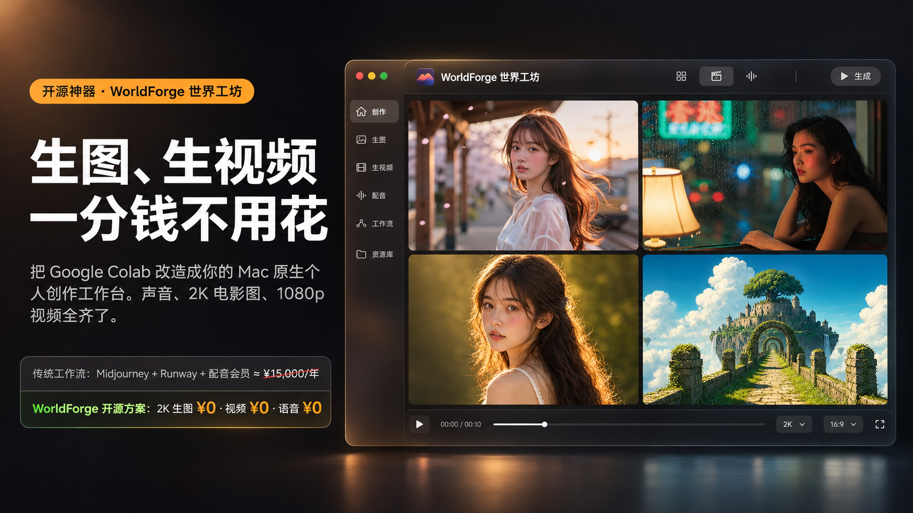
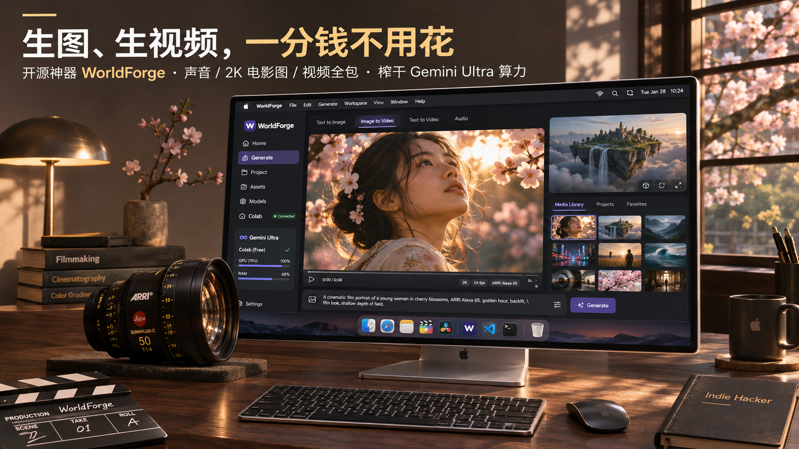
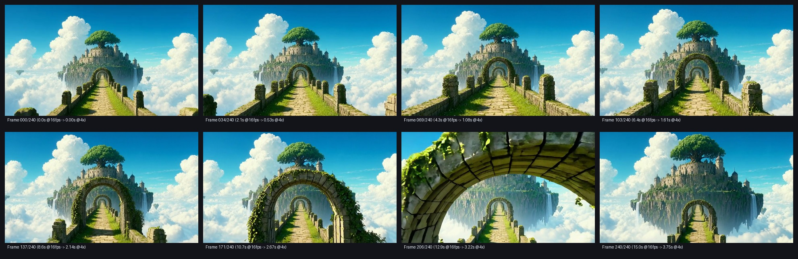

# 炸了，分享一个开源 AI 神器：生图、生视频、配音全齐了，一分钱不用花



````carousel

<!-- slide -->

<!-- slide -->

<!-- slide -->

````

---

## 备选标题（公众号 / 知乎 / B站 / 小红书 / X 长文）

- **标题 1**：炸了，分享一个开源 AI 神器：生图、生视频、配音全齐了，一分钱不用花
- **标题 2**：别再按条充视频积分了，我用这个开源神器把 Colab 改造成了免费个人创作工作台
- **标题 3**：生图 0 元、生视频 0 元：我把 Google Colab 和 30TB 云盘搬进了 Mac 原生工作台

---

## 正文（按 Sub2API `gpt-6.1-sol` 去 AI 腔 v3.3 铁律成稿）

前两天算了一笔账。

做 AI 图片和视频，最贵的还不是软件。

是废片。

生图开个 Midjourney，一个月 60 美元。

生视频再去开 Runway，或者给可灵、海螺充积分。

平时出片勤一点，一个月光买积分又是小一千。

最肉疼的是抽卡机制。

提示词没写准，扣钱。

人物手指崩了，扣钱。

视频镜头跑偏了，还是照样扣钱。

那自己买显卡在本地跑呢？

现在主流的 14B 视频大模型和 2K 生图模型，真要配一台不爆显存的机器，预算直接奔着三四万去了。

今天分享一个我刚搓出来并彻底开源的项目。

**WorldForge，中文叫世界工坊。**

开源地址：https://github.com/designfuchen/worldforge

它干的事情特别直接。

把 Google Colab 的云端显卡和 Google 云盘，通过加密隧道直接接到你的 Mac 桌面上。

吃算力的生图、生视频、3D 渲染全在云端跑。

留给你自己的，是一个干净顺手的 Mac 原生个人创作工作台。

**生图不要钱。**

**生视频不要钱。**

**连 AI 配音和 3D 世界生成也全塞进去了，一分钱不用多花。**

因为跑的是你自己的云端环境，没有按张扣费，也没有按条扣视频积分。

废片随便重来，试错成本直接归零。


### 我最想省掉的，是来回折腾

以前做一条完整的视频，工具全是散的。

生图开一个网页。

图生视频换另一个网页。

配音再去开第三个网站。

生成完挨个下载，最后回剪辑软件里满文件夹找文件。

如果用传统网页版 Colab 自己跑开源模型，体验更折磨。

浏览器切个后台就断连。

每次重启会话，几十个 G 的模型权重又得重新拉一遍，光等下载就要二十多分钟。

WorldForge 直接把这套流程改成了单线闭环。

你坐在 Mac 前点按钮。

后台通过 SSH 隧道直连云端显卡，生成的图片、视频、音频自动回传到桌面。

### 左边只填三步，中间看大图，右边管素材


我很讨厌满屏幕参数和连线的界面。

所以 WorldForge 整个窗口就分成了左、中、右三栏。

左边负责生成，操作收成了固定三步：

**第一步，选模型。**

内置了 `Qwen-Image 2.1 Turbo`、`FLUX.1`、`Wan 2.1 14B`、`MiniMax-H3` 等生图和视频模型。

点一下就能切换。

想加 HuggingFace 上的新模型，点右上角「+ 添加模型」，输入名字就能直接拉进云盘。

**第二步，写一句大白话。**

不用背几百个英文权重词。

比如你只写一句：

`一位绝美少女回眸`

点一下旁边的「电影级扩写」，系统会自动补全光线、景深和胶片细节。

如果懒得想画面，下面直接放好了 8 个经典电影场景预设。

《情书》樱花逆光、《花样年华》暗夜雨窗、《沙丘》丁达尔丝绸、《千与千寻》万灯水乡、《天空之城》浮空古树。

点一下就能直接拿来出图。


**第三步，选一台电影摄影机。**

很多人觉得开源模型出的图有塑料感，其实差在光学镜头描述上。

我在第三步直接内置了 6 套专业电影摄影机预设：

- **岩井俊二·黄金逆光柔焦**：`ARRI Alexa 65 + Canon FD 85mm f/1.2L + Black Pro-Mist 1/4 黑柔滤镜`
- **王家卫·暗夜霓虹变形宽银幕**：`ARRI Alexa Mini LF + Cooke Anamorphic 40mm T2.0`
- **迪金斯·丁达尔黄金史诗**：`IMAX MSM 65mm + Panavision Sphero 65`
- **徕卡夜神·f/0.95 刀锐奶化**：`Sony Venice 2 8K + Leica Noctilux-M 50mm f/0.95`
- **新海诚·暮光云海星芒镜头**：`Panavision DXL2 8K + Ultra Panatar 1.3x`

点选摄影机之后，按左下角的「立即生成」。

几秒钟就能直出带胶片高光溢出和真实光学散景的 2K 剧照。

````carousel

<!-- slide -->

<!-- slide -->

````

生成好的图直接显示在正中间的大画布上。

看中哪张图，点底部按钮就能直接「用此图生视频」，或者调用英伟达 `Lyra 2.0`「用此图生 3D 世界」。

最右边一整列是常驻的「素材库」。

不管是图片、视频还是配音，生成完自动归档到这里，最新生成的永远排在最前面。

再也不用去文件夹里翻半天了。

### 30TB 云盘 + 177G 内存 + 0 显存配音是怎么配合的

如果你手里有 Gemini Ultra（Google One AI Premium）账号，这套工具能把你的隐藏权益彻底榨干。

我们把云端硬件分成了四层来用：

1. **Google Drive 云盘（最高 30TB）**：当永久模型金库。几百 GB 的生图和视频大模型只用下载一次，以后永久保存在云盘里，断连重启也不用重下。
2. **主机内存（最高 177GB DDR5）**：当热备缓存池。暂时不用的模型退到内存里，切换模型只要 0.6 秒。
3. **`/dev/shm` 内存盘（88GB）**：视频合成和高速读写全部走内存盘，不卡磁盘 IO。
4. **GPU 显存（最高 96GB）**：100% 留给当前正在跑的生图或视频大模型。

至于配音，项目里集成了 `Breeze-TTS-2` 中文语音模型。

它的 7.16GB 权重直接放在 Google 云盘上，运行时加载到 177GB 主机内存里用 CPU 推理。

**GPU 显存占用是 0 MB。**

显卡专心画图跑视频，内存顺手把配音干了，互不抢资源。

### 三步把工作台跑起来

打开 Mac 终端，执行下面三行命令就能启动：

```bash
# 1. 克隆开源仓库并安装轻量依赖
git clone https://github.com/designfuchen/worldforge.git
cd worldforge && pip install -r requirements.txt

# 2. 启动本地守护进程（自动建立并复用 Colab SSH 隧道 + 挂载云盘金库）
python3 forge.py --port 7788

# 3. 编译并打开 macOS 原生客户端（或浏览器直接打开 http://127.0.0.1:7788）
bash macos_app/build_macos_app.sh && open /Applications/WorldForge.app
```

生图不用再按张买会员。

生视频不用再心疼废片扣积分。

声音、图片、视频、3D 世界全在一个桌面工作台里搞定。

开源仓库地址：https://github.com/designfuchen/worldforge

---

# 附：X (Twitter) / 小红书 首发帖（阿磊单线大白话版）

### 主帖（直接复制发布，配上面 4 张 Sub2API 封面图）

炸了，分享一个开源 AI 神器。

平时做 AI 图片和视频，最贵的其实不是软件，是废片。

Midjourney 一月 60 刀。

视频再开 Runway，或者给可灵、海螺充积分，用得勤一点一个月又是小一千。

提示词没写对，扣钱。

镜头跑偏了，照样扣钱。

想自己配一台不爆显存的大机器，预算又得奔着三四万去。

干脆自己动手搓了个开源项目：WorldForge（世界工坊）。

直接把 Google Colab 的云端显卡和 30TB 云盘，通过 SSH 隧道接进 Mac 原生工作台。

吃算力的活全在云端跑，操作留在桌面。

生图不要钱。

生视频不要钱。

连 AI 配音和 3D 世界生成也全齐了，没有按张收费，也不按条扣视频积分。

界面砍掉了所有复杂连线，左边只做三步：

1. 选模型（支持一键从 HF 拉新模型进云盘）
2. 写一句大白话（内置《情书》《花样年华》等 8 个电影名场面预设）
3. 选摄影机（内置 ARRI Alexa 65 + 85mm f/1.2 黑柔镜、王家卫 Cooke 40mm 变形宽银幕等 6 套电影镜头）

中间是大屏预览，看中哪张图直接一键转视频或生成 3D 世界。

右边是常驻素材库，最新生成的图片和视频自动排最前。

配音接了 Breeze-TTS-2，模型存在云盘，加载到主机内存里跑，0 显存占用，一点不抢生图和视频的显存。

仓库地址和三步启动命令放一楼。

### 一楼自回复

WorldForge 开源仓库：
https://github.com/designfuchen/worldforge

Mac 终端三步跑起来：

```bash
git clone https://github.com/designfuchen/worldforge.git
cd worldforge && pip install -r requirements.txt
python3 forge.py --port 7788
```
